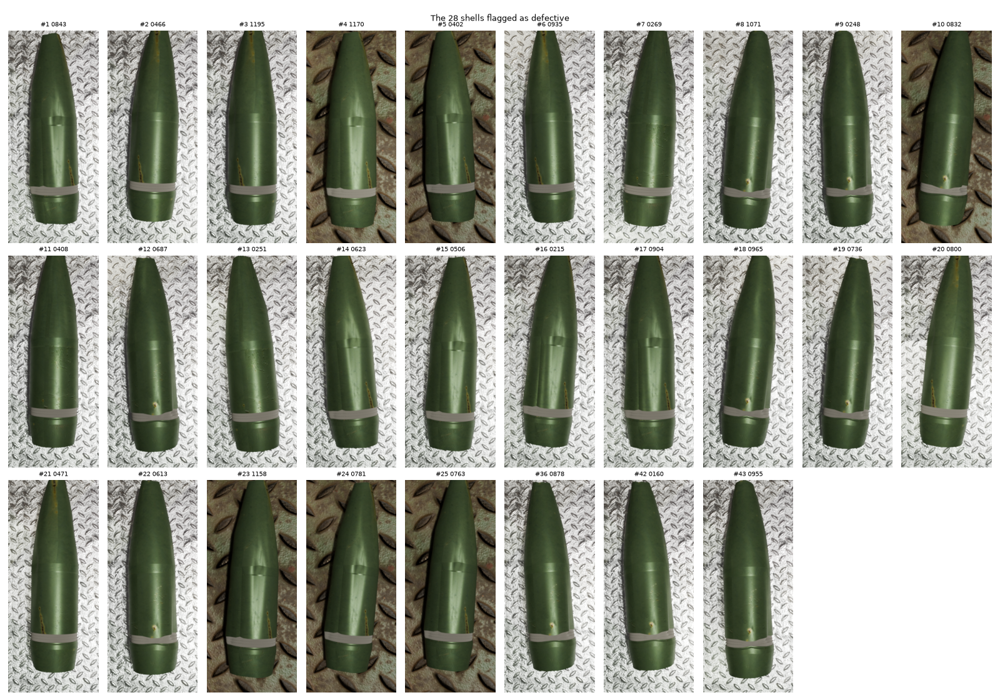

# Bad BOMB

- **Continent:** Asia
- **Country:** Laos
- **Domain:** Computer Vision
- **Difficulty:** Medium
- **Points available:** 200
- **Answer type:** Evaluated file (`test-output.txt`), flag released at ≥ 70% accuracy
- **Platform status:** Passed (20/28 matched, accuracy 0.714)

## Objective

1225 unlabeled photos of artillery shells, about 2% of them (28) defective. Find the 28 defective shells and submit them in `test-output.txt`, one `images/image_XXXX.png` per line. Score = share of the 28 ground-truth defects in the list; at least 70% passes.

## Data

1225 photos (512×512) of the same type of green shell with a grey band, on one of two metal plates (white or rusty checker plate), with small changes in lighting, angle and position. The download also contains 16 files named `image_XXXX(1).png`, which are byte-identical duplicates and are skipped. There are no labels.

## Approach: unsupervised anomaly detection (PatchCore-style)

1. **Describe every patch.** A WideResNet-50 pretrained on ImageNet (torchvision) is used as a frozen feature extractor. Its layers 2 and 3 turn every ~8×8-pixel area of a photo into a feature vector (64 × 64 = 4096 patches per photo, 256 numbers each after a fixed random projection).
2. **Find the shell.** The shell is the large green region of the photo (body above and below the band, with the grey band bridged). Only patches on the shell are scored, because stains on the metal plate are not defects.
3. **Compare with look-alikes.** For each photo we take the 40 most similar photos overall (same background, lighting, angle). A patch's anomaly score is the distance to the closest patch in those 40 photos. Normal paint, the band and the small yellow dot that every shell has always find a near-twin; a scratch, hole or notch does not.
4. **Rank.** Photo score = highest patch score on the shell.
5. **Review.** We looked at the top 80 shells at full resolution and kept those with a visible mark.

## What we saw in the top-ranked shells

| Type | What it looks like |
|---|---|
| Notch | rectangular cut in the shell body, often with a scratch |
| Long scratch | thin yellow-orange scratch line on the body |
| Hole with dented band | hole just above the band, band pushed in |
| Scuffed patch | rough, cracked area on the body |

Ranks 1–25 all showed one of these marks. Ranks 26–80 looked normal, except four holes with a dented band (#36, #42, #43, #54), which score lower because the hole sits where normal shells have their small yellow dot. That gave 29 candidates; we submitted the 28 with the highest scores (leaving out `image_0520.png`, #54).

## Attempts

| # | What we tried | Result |
|---|---|---|
| 1 | Whole image at 320 px | ~20 clear defects, then background stains on the metal plate filled the ranking |
| 2 | Full 512 px, only the shell scored | top ~25 almost all with a visible mark; thin scratches visible |
| 3 | First shell mask (largest green region only) | missed the part below the band and leaked into the background on some rows |
| 4 | Fixed mask (all large green regions, band bridged) | cleaner top 25, holes moved up the ranking |
| 5 | Searching for patches similar to the confirmed defects | found no further candidates |

## Result

- **Submitted file:** `test-output.txt` (28 shells)
- **Platform result:** passed, 20/28 defective shells matched (accuracy 0.714, threshold 0.7)
- 8 of our picks were not in the official list, so some official defects are subtler than what we could confirm by eye.

## Reproduce

1. Download the `images/` folder from the task's [Google Drive folder](https://drive.google.com/drive/folders/1NY2_0QtTSZC7k439HWP8SUMOrEeFEUow) into `bad-bomb/data/images/`.
2. Use a Python environment with `torch`, `torchvision` (CUDA GPU recommended, ~8 GB), `numpy`, `pandas`, `scipy`, `pillow`, `matplotlib`.
3. Open `solve.ipynb` from the `bad-bomb/` folder and run all cells. The first run downloads the pretrained WideResNet-50 weights (132 MB) automatically. Scoring takes about 10–15 minutes on a laptop GPU. (Scoring time may vary depending on hardware)
4. The notebook writes `ranking.csv`, `test-output.txt` and `figures/final_28.png`.