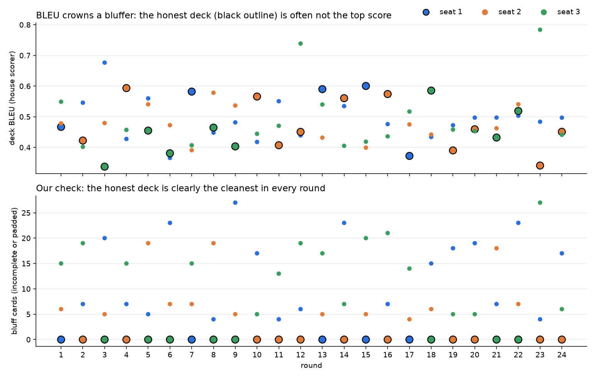

# Call My BLEUff

- **Continent:** Europe
- **Country:** United Kingdom
- **Domain:** Classic ML & Data Science
- **Difficulty:** Medium
- **Points available:** 200
- **Answer type:** Flag, supported by evidence (this folder)
- **Flag:** `SIGMOID_FRINDLOW`

## Objective

In each of 24 rounds, three panellists describe the same 40 venues (cafés, pubs, restaurants). One is honest and two bluff to please BLEU, the show's scorer. Find out how the bluffers game BLEU, build a check that catches them, name the honest panellist of every round, and spell the flag from their seats (3 rounds per letter, base 3).

## How the bluffers game BLEU

BLEU (`bleu.py`) multiplies n-gram precision (how many 1–4-word chunks of the description also appear in a reference) by a brevity penalty. Two details of the configuration matter:

- the **brevity penalty is computed once for the whole deck**, comparing each card with its **closest** reference length;
- BLEU only counts matching word chunks. It never checks whether the **facts** about the venue are there, or whether they are said twice.

The bluffers use three tricks:

| Trick | Example | Why BLEU likes it |
|---|---|---|
| **Omission** | "There is a Fast food restaurant named The Golden Curry." | Every word matches a reference, so precision is very high. A short card is compared with the shortest reference, so it costs almost nothing. Most facts are missing. |
| **Word salad** | "There is a coffee shop called not cheap, however it centre." | Built from reference phrases, so many n-grams match, but facts get lost. |
| **Padding** | "The Vaults is a riverside coffee shop with a price range of £20-£25 … In the riverside area near Café Brazil there is a coffee shop called The Vaults which has a price range of £20-25 …" | Two descriptions glued together: more matching n-grams, and the extra length cancels the brevity penalty of the short cards. |

Some bluffers use a trick on most of their cards. Others only drop facts on a handful.

## Our check

BLEU compares words, but the same fact is written in many ways ("cheap" = "less than £20" = "affordable"). So we built a **fact checklist**: for every venue fact (price, customer rating, family-friendly, area, food, venue type) we listed the phrases people use for each value, by reading the references.

For every card:

1. **Complete?** The venue's facts are the values that at least 2 of the 5 references agree on, plus the names (venue and landmark) that at least 3 references mention. **Coverage** = share of those the description states. Below **75%** → *incomplete*.
2. **Padded?** Longer than **1.2×** a typical (median) reference **and** at least 2 facts stated in two different sentences. Repeating only the venue's name does not count, since people naturally write "The Golden Curry … The Golden Curry is".

A card that is incomplete or padded is a **bluff card**. The honest panellist's deck should have none.

## Results

| | |
|---|---|
| Rounds where exactly one deck has 0 bluff cards | **24 / 24** |
| Bluff cards in the other decks | 4 to 28 |
| Smallest margin between honest deck and next deck | **4 cards** |
| Rounds where BLEU picked the honest panellist | 8 / 24 (about chance) |

Honest seats, rounds 1–24: `1 2 3 | 2 3 3 | 1 3 3 | 2 2 2 | 1 2 1 | 2 1 3 | 2 2 3 | 3 2 2`

| Rounds | Seats | Digits | 9·d1 + 3·d2 + d3 | Letter |
|---|---|---|---|---|
| 1–3 | 1 2 3 | 0 1 2 | 5 | F |
| 4–6 | 2 3 3 | 1 2 2 | 17 | R |
| 7–9 | 1 3 3 | 0 2 2 | 8 | I |
| 10–12 | 2 2 2 | 1 1 1 | 13 | N |
| 13–15 | 1 2 1 | 0 1 0 | 3 | D |
| 16–18 | 2 1 3 | 1 0 2 | 11 | L |
| 19–21 | 2 2 3 | 1 1 2 | 14 | O |
| 22–24 | 3 2 2 | 2 1 1 | 22 | W |

BLEU's choice spells `SKELDRAP`. Our check spells **`SIGMOID_FRINDLOW`**.

## What we tried that did not work

- **Single signals** (card length, long copied word runs, repeated phrases, n-gram precision): each caught some bluffers but none separated the honest deck in every round.
- **Language-model fluency (GPT-2)** and **classifiers** (logistic regression, gradient boosting) combining those signals: they found the heavy bluffers but not the light ones, because a short, correct sentence looks perfectly normal. Leaving facts out is invisible to them.
- **Looking for wrong facts** (bluffs as lies, like on the TV show): almost none. The bluffers don't lie, they leave facts out or repeat them.
- **Plain keyword overlap** instead of the fact checklist: failed, because the same fact is written in different words. That is BLEU's own weakness.
- The phrase lists were refined by checking every honest card that got flagged. Each time it was a phrasing we hadn't listed ("3 of 5", "£20 to 25", "Children welcomed"). Fixing those only removed false flags; the answer never changed.

## Reproduce

1. Download `references.csv`, `panel.csv` and `bleu.py` from the task's [Google Drive folder](https://drive.google.com/drive/folders/1Ycd99_NLLKqwjW80B3sca9KGNodF2pNW) and place them in `call-my-bleuff/data/`. 
2. Use a Python environment with `pandas`, `numpy`, `matplotlib` and a Jupyter kernel.
3. Open `solve.ipynb` from the `call-my-bleuff/` folder, restart the kernel and run all cells. The last cells print the flag and save `figures/evidence.png`.