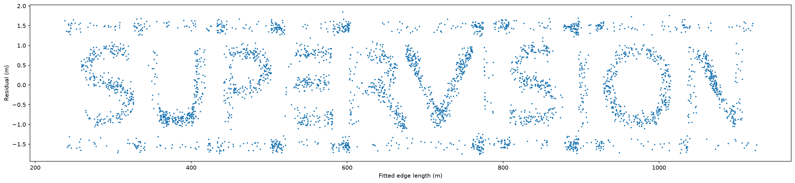

# Fry-ndship

- **Continent:** Europe
- **Country:** Belgium
- **Domain:** Classic ML & Data Science
- **Difficulty:** Easy
- **Points available:** 100
- **Answer type:** Flag, supported by fitting code and a figure
- **Platform status:** Accepted
- **Accepted flag:** `SIGMOID_SUPERVISION`

## Objective

Model potato fields' edge lengths from their declarations and find the word hidden in Mariette's measurements. The expected flag format is `SIGMOID_<WORD>`.

## Attempts

We tried two ordinary least squares model specifications, both with an intercept. For each one, we plotted residuals against fitted edge length.

| Attempt | Predictors | In-sample R² | Word in residuals | Platform result |
|---|---|---|---|---|
| 1 | `long_side_m`, estimated `short_m` | 0.9983673004221523 (approximately 99.83673%) | REGRESSION | `SIGMOID_REGRESSION` was rejected |
| 2 | `long_side_m`, estimated `short_m`, `ditch_m` | 0.9999843184785999 (approximately 99.99843%) | SUPERVISION | `SIGMOID_SUPERVISION` was accepted |

### First attempt: field dimensions only

We treated each field as approximately rectangular, converted its area from hectares to square metres, and estimated the short side as `short_m = area_ha * 10_000 / long_side_m`.

The first model used the long and estimated short sides. Its fitted equation was approximately `predicted edge_m = 1.9 * long_side_m + 1.9 * short_m`, with an intercept close to zero. Although the model explained approximately 99.84% of the variation and its residual plot spelled REGRESSION, the platform rejected that answer.

### Accepted attempt: include declared ditch length

We added `ditch_m` to the predictors and fitted the model again. Ditch length comes from the farmer's declaration, so it is available before Mariette's survey. Its omission from the first attempt was a modeling choice, not a restriction imposed by the task.

The accepted model is:

`edge_m = intercept + b1 * long_side_m + b2 * short_m + b3 * ditch_m + residual`

All coefficients were estimated again together. The side coefficients changed from approximately 1.9 to approximately 0.9, and the ditch coefficient was approximately 1.0. This changed both the fitted values and the residuals. Plotting `residual = observed edge_m - fitted edge_m` against the new fitted values revealed SUPERVISION, and the platform accepted the resulting flag.

The on-site hedge measurement and the post-survey fencing quote remain excluded because they are unavailable for prediction from declarations alone.

## Geometry and interpretation

Here, `edge_m` is the measured boundary length to be fenced. We use the rectangle approximation to estimate the missing short side; we do not force the regression to obey the exact rectangle perimeter formula `2 * (long_side_m + short_m)`.

A ditch runs along the field and does not automatically add extra geometric perimeter. Including `ditch_m` lets the regression use its relationship with measured edge length in this dataset. The fitted coefficients describe that statistical relationship; they do not establish a physical rule that ditch length must be added to a rectangle's perimeter.

The two attempts show that residuals depend on the chosen model. A high R² and a readable pattern in one residual plot were insufficient to establish the accepted answer.

## Reproduce

1. Download `potato_fields.csv` from the Fry-ndship task page on [the competition platform](https://sigmoid.academy/) and place it at `fry-ndship/data/potato_fields.csv`. The CSV is not tracked in Git.
2. Run locally on your own machine using a Python environment with `pandas`, `statsmodels`, `matplotlib`, and a Jupyter kernel such as `ipykernel`. The saved notebook used Python 3.14.10. Select your local environment as the notebook kernel. The root `requirements.txt` does not currently include `statsmodels` or `ipykernel`, so install those as well when preparing a fresh environment.
3. Set the notebook's working directory to your local repository root (the folder containing `fry-ndship/`), then open [solve.ipynb](solve.ipynb).
4. Use the current model with `long_side_m`, `short_m`, and `ditch_m`. Restart the kernel, run all cells in order, and save the outputs. The current notebook reproduces the accepted second attempt.
5. Read SUPERVISION from the residual plot. The notebook saves the figure to `fry-ndship/figures/residuals.png`, relative to your local repository root.

The first attempt is documented above as the earlier rejected model. The current code and saved figure correspond to the accepted second attempt.

## Accepted result

The notebook's saved numerical output reports:

- **In-sample R²:** 0.9999843184785999 (approximately 99.99843%)
- **Intercept:** -0.001098
- **Long-side coefficient:** 0.900019
- **Estimated short-side coefficient:** 0.900023
- **Ditch-length coefficient:** 0.999980
- **Observed word:** SUPERVISION
- **Accepted flag:** `SIGMOID_SUPERVISION`

The platform accepted the submission, as confirmed by the team after submitting it. The exact submission timestamp and the submitted commit URL have not been recorded here.

