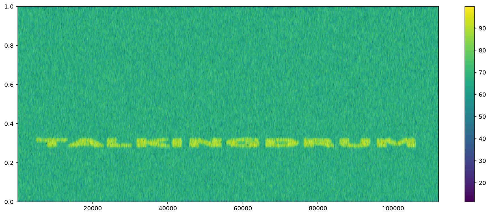

# The Gángan Never Lies

- **Continent:** Africa
- **Country:** Nigeria
- **Difficulty:** Easy
- **Points available:** 100
- **Answer type:** Flag, supported by a notebook and a figure
- **Flag:** `SIGMOID_TALKINGDRUM`
- **Platform status:** Passed (100 pts)

## Statement

### Storyline

Long before phones reached the villages around Ibadan, news travelled by drum. The gángan — the Yoruba talking drum — is built with a waist of leather cords that a player squeezes under the arm, bending its pitch up and down to mimic the rise and fall of spoken Yoruba. A skilled ayan drummer doesn't really play a rhythm, he speaks one: praise names, warnings, proverbs, all carried on tone, sent across a market square to whoever still knows how to listen for it.

You've been helping SIGMOID's small audio archive team digitize old field recordings for a heritage project out of Lagos — mostly drumming, chanting, the odd bit of market noise caught on tape by accident. Somewhere in this week's batch sits one file the archive's old sound engineer left behind before he retired. Everyone who worked with him says the same thing: the man never wrote a note down or said out loud what he didn't want repeated. If he needed to leave something for the next person, he tucked it away somewhere he was fairly sure nobody would bother looking.

The file is called challenge.wav, and it's labelled, unhelpfully, "test tone — ignore." Play it and the label checks out: a flat, slightly buzzing hiss, the kind of thing you'd normally delete without a second thought. Nobody left this recording in the archive by accident, though — not with that name, not from him.

### Objective

Figure out what's actually inside challenge.wav, pull out whatever the engineer left there, and hand it in as the flag.

### Task input

`challenge.wav` — a 16-bit PCM WAV file, mono, ~10 seconds, sampled at 22050 Hz.

### Expected output

The flag in the format `SIGMOID_<WORD>`.

### Scoring

- Correct flag: 100 points (PASS)
- Incorrect or missing flag: 0 points (FAIL)

## Approach

The statement says the talking drum speaks by bending its pitch and that the message is "carried on tone", while the file itself sounds like a flat hiss. Pitch is frequency, so we looked at how the frequencies in the recording change over time: a spectrogram.

A spectrogram cuts the recording into short windows, measures how much energy each frequency has in every window (a Fourier transform), and draws the windows side by side. Time runs left to right, frequency runs bottom to top, and colour shows the energy.

The [notebook](solve.ipynb) reads the file with `scipy.io.wavfile.read` and draws it with matplotlib's `plt.specgram(x)` using the default settings. The spectrogram shows the word **TALKINGDRUM** written in bright letters on top of the noise.

### Why it works

The engineer hid the word by treating a picture of the text as a spectrogram: every lit pixel became a short tone at that pixel's frequency and moment. Many short tones played together sound like a buzzing hiss, so by ear the file really is a "test tone". Drawing the spectrogram reverses the trick and shows the picture again.

### Reading the axes

We kept matplotlib's defaults (windows of 256 samples, sample rate assumed to be 2), so the axes are not in seconds and Hz:

- **Vertical:** a fraction of the highest frequency the file can hold, where 1.0 is 11025 Hz (half the 22050 Hz sample rate). The letters sit at about 0.28–0.33, roughly 3.1–3.6 kHz.
- **Horizontal:** the sample index divided by 2. The letters span about 5,000–106,000, roughly from 0.5 s to 9.6 s of the recording.

Passing `Fs=rate` would label the axes in seconds and Hz. It is not needed to read the word.

## Attempts

| # | What we tried | Result |
|---|---|---|
| 1 | Spectrogram of the whole file, default settings | The word TALKINGDRUM is readable |

The spectrogram was the first thing we tried and nothing else was needed. If it had shown only noise, the next checks would have been the lowest bit of each sample and the shape of the raw waveform.

## Reproduce

1. Download `challenge.wav` from the task page on [the competition platform](https://sigmoid.academy/) and place it at `the-gangan-never-lies/data/challenge.wav`. The file is not tracked in Git.
2. Use a Python environment with `scipy`, `matplotlib` and a Jupyter kernel such as `ipykernel`. The saved notebook used Python 3.14.10. The root `requirements.txt` does not include `scipy` or `ipykernel`, so install those as well.
3. Set the notebook's working directory to the repository root (the folder containing `the-gangan-never-lies/`), then open [solve.ipynb](solve.ipynb).
4. Restart the kernel and run the cell. It shows the spectrogram and saves it to `the-gangan-never-lies/figures/spectrogram.png`.
5. Read TALKINGDRUM from the figure.

## Result

- **Observed word:** TALKINGDRUM
- **Flag:** `SIGMOID_TALKINGDRUM`, accepted by the platform (100 pts)
- **Submission time:** not recorded
- **Commit:** [b2d3b29](https://github.com/maxpricop/lmml-team/commit/b2d3b29a4899166bd5f6bd0298f31cf4b4278403)
